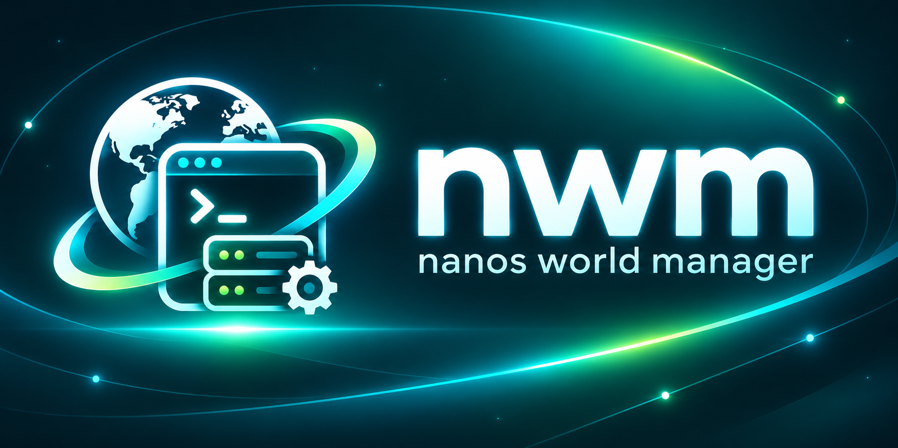

<p align="center"></p>

# 🌍 nwm - nanos world manager

A cross-platform CLI (Windows and Linux) that takes the busywork out of running [nanos world](https://nanos-world.com) servers.

📖 **Documentation: [nwm.dasdarki.de](https://nwm.dasdarki.de)**

## Install

**Linux**

```sh
curl -fsSL https://raw.githubusercontent.com/DasDarki/nwm/main/install.sh | sh
```

**Windows** (PowerShell)

```powershell
irm https://raw.githubusercontent.com/DasDarki/nwm/main/install.ps1 | iex
```

The installers verify the download against `checksums.txt`, need no admin rights and add nwm to your `PATH`
(Linux: `~/.local/bin`, registered in `.profile`, `.bashrc`, `.zshrc` and fish; Windows: `%LOCALAPPDATA%\Programs\nwm`, registered in the user `PATH`).
Set `NWM_VERSION` to install a specific release and `NWM_INSTALL_DIR` to change the location.

Alternatively download the binary from the [latest release](https://github.com/DasDarki/nwm/releases/latest).
Afterwards nwm keeps itself up to date:

```sh
nwm self-update
```

## Quick start

```sh
nwm server create dev --port 7777 --nanossharp
nwm package install sandbox --enable
nwm server start dev
```

## Commands

| Command | Description |
|---|---|
| `nwm server create <name>` | Install a server via SteamCMD (downloaded automatically) |
| `nwm server import <name> <dir>` | Register an existing installation |
| `nwm server update [name]` | Update to the latest build, `--branch bleeding-edge` switches branches |
| `nwm server list` / `info` | Show servers and their status |
| `nwm server start [name]` | Run in the foreground, or in the background with `-d` |
| `nwm server stop` / `restart` / `logs -f` | Control background servers |
| `nwm server config [get\|set]` | Read and edit `Config.toml` |
| `nwm package install\|update\|list\|remove\|enable\|disable` | Manage packages from the vault |
| `nwm assets install\|update\|list\|remove\|enable\|disable` | Manage asset packs from the vault |
| `nwm nanossharp install\|update\|uninstall` | Manage [NanosSharp](https://nanossharp.dasdarki.de) |
| `nwm recipe init\|edit\|add\|rm\|show\|convert\|validate` | Write recipes, interactively or from the shell |
| `nwm recipe apply\|upgrade\|info\|search` | Use recipes |
| `nwm recipe publish\|unpublish` | Share recipes through the registry |
| `nwm service list\|add\|up\|down\|logs\|remove` | Manage Docker services of a server |
| `nwm secret list\|get\|set\|rotate\|remove` | Manage a server's passwords and tokens |
| `nwm dev` | Develop packages locally with live reload |
| `nwm server cmd\|attach` | Send console commands to background servers |
| `nwm self-update` | Update nwm itself |

Short aliases: `nwm s` (server), `nwm p` (package), `nwm a` (assets), `nwm n`/`nwm ns` (nanossharp), `nwm r` (recipe),
`nwm svc` (service), `nwm sec` (secret) and `nwm su` (self-update).

Commands that target a server pick it by name, by the current directory, or automatically when only one server exists.

## Recipes

A recipe describes a complete server setup. It is a `Recipefile` (or a `recipe.toml`) plus any files it references.

```sh
nwm recipe init --name @you/roleplay
nwm recipe edit
nwm server create dev --recipe . --var port=7790
nwm recipe apply @dasdarki/roleplay@^1 -s dev
nwm recipe upgrade -s dev
```

### Writing recipes

`nwm recipe edit` opens a full screen editor: every statement below is a command, Tab completes commands,
packages and asset packs from the nanos world store, service presets, `Config.toml` keys and files.
`undo`, `remove <kind> <name>`, `validate`, `save [toml|dsl]` and `help` are available as well.

The same statements work from the shell, with shell completion:

```sh
nwm recipe add package sandbox enable
nwm recipe add use postgres
nwm recipe rm package sandbox
nwm recipe show --format toml
nwm recipe convert --to toml
nwm recipe init staging.Recipefile
nwm recipe add -C staging.Recipefile config discover.port 7790
```

### Recipefile

```
recipe @you/roleplay 1.0.0
description "Roleplay development server"
author you
keywords roleplay postgres

branch public
nanossharp
arg --log_level 2

var port 7777

config discover.name "RP ${server.name}"
config discover.port ${port}
config custom_settings.spawn_cars true

package sandbox enable
package roleplay-core git https://github.com/you/roleplay-core.git ref v2.1.0 enable
package dev-tools path packages/dev-tools
assets nanos-world

module mysql linux https://example.com/libmysql.so windows https://example.com/mysql.dll enable
file files/NanosSharp.toml NanosSharp.toml template

use postgres
use redis port 16379
service search getmeili/meilisearch:v1 port 7700 volume search-data:/meili_data

secret steam_token prompt
env STEAM_TOKEN ${secret.steam_token}
hook in Packages/roleplay-core dotnet build
```

One statement per line, `#` starts a comment. Words are split at spaces, `"..."` allows escapes, `'...'` is literal.
Unquoted values of `var` and `config` keep their type (`7777`, `true`, `[a, b]`), quoted values are strings.
Named entries (`package x`, `service x`, `var x`, `config k`, `env K`) replace earlier ones, `arg` and `hook` append.

| Statement | Alias | Effect |
|---|---|---|
| `recipe <name> [version]` | | Name (scoped like `@you/name` for the registry) and version |
| `description`, `author`, `keywords` | | Metadata shown in the registry |
| `branch public\|bleeding-edge` | | Steam branch |
| `nanossharp [on\|off]` | | Install NanosSharp |
| `arg <args>...` | | Server launch arguments |
| `var <name> <default>` | | Variable used as `${name}`, overridable with `--var name=value` |
| `config <key> <value>` | `cfg` | Value in `Config.toml`, e.g. `discover.port` |
| `package <name> [enable] [git <url>] [ref <ref>] [subdir <dir>] [path <dir>]` | `pkg` | Package from the vault (name only), git or the recipe folder. `enable` loads it |
| `assets <name> [...]` | `asset` | Asset pack, same options |
| `module <name> [linux <src>] [windows <src>] [enable]` | `mod` | C module package built from prebuilt `.so`/`.dll` files or archives (URL or recipe path) |
| `file <source> <target> [template]` | | Copy a file or folder into the server, `template` expands placeholders |
| `use <image> [as <name>] [port <host port>] [env K=V]...` | `require_service`, `requires` | Service with presets, see below |
| `service <name> <image> [port <p>] [env K=V] [volume <v>] [ready "<check>"] [nowait] [command <args>...]` | `svc` | Docker service started with the server |
| `secret <name> [random [length] \| prompt]` | | Value from the secret store, used as `${secret.name}` |
| `env <KEY> <value>` | | Written to the server's `.env` and passed to the server process, can use `${env.OTHER}` |
| `expose <KEY>...` | | Makes env values readable in Lua through `Server.GetCustomSettings()` |
| `hook [in <dir>] <command>...` | | Run after applying, remote recipes ask first |

Built-in variables: `${server.name}`, `${server.path}`, `${os}`.
`recipe.toml` holds the same data as TOML tables (`[recipe]`, `[server]`, `[variables]`, `[config]`, `[[package]]`,
`[[assets]]`, `[[module]]`, `[[file]]`, `[[service]]`, `[[secret]]`, `[env]`, `[[hook]]`), see `nwm recipe show --format toml`.

### C modules

C modules are packages of type `c_module` ([docs](https://docs.nanos-world.com/docs/core-concepts/packages/c-module)).
Install them like any package (vault, `git`, `path`) or let `module` build one from prebuilt binaries: nwm puts them into
`Packages/<name>/` and writes a `Package.toml` with `[c_module] modules = [...]` unless the archive ships one
(`libexample.so` and `example.dll` become the module `example`).

The server only loads C modules when started with `--enable_unsafe_libs`, which also unlocks unsafe Lua libraries.
Recipes may request it with `arg --enable_unsafe_libs`, but nwm asks once before the first start of each server:
`[y]` allows it for this server, `[a]` for all servers, anything else starts the server without the flag. Without a
terminal the flag is dropped with a warning. nwm asks again when new C modules are enabled. The approval lives in
`~/.nwm/state.toml`, out of reach for recipes.

| Command | Effect |
|---|---|
| `nwm s start <name> --allow-unsafe-libs` | Approve without asking (scripts, CI) |
| `nwm s start <name> -- --enable_unsafe_libs` | Pass the flag yourself for one start |
| `nwm s trust [name]` | Show or grant the approval |
| `nwm s trust [name] --revoke` | Withdraw it |
| `nwm s trust --global [--revoke]` | Always allow it for every server, or stop doing so |

### Service presets

`use` knows `postgres`, `mysql`, `mariadb`, `redis`, `valkey`, `mongo`, `rabbitmq`, `meilisearch` and `minio`.
It picks a sensible image, port, data volume and readiness check, generates a password secret and writes connection
values to `.env`, e.g. `use postgres` provides `DATABASE_CONNECTION` for the nanos world `Database` class and `DATABASE_URL` for other programs. `port` changes the host port, other images become plain services.
Ports bind to `127.0.0.1` unless an IP is given. nwm waits until a service is ready before the server starts.

### Secrets

Secrets live per server in `~/.nwm/secrets/<server>.toml` (readable only by you), never in the recipe or the server folder.
`random` secrets are generated on the first apply and stay stable across upgrades, `prompt` secrets are asked for
(or passed with `--secret name=value`). Manage them with `nwm secret list|get|set|rotate|remove -s <server>`.

### Sources

| Source | Example |
|---|---|
| Registry | `@dasdarki/roleplay`, `@dasdarki/roleplay@^1`, `roleplay@1.2.0` |
| GitHub | `github:owner/repo`, `github:owner/repo/sub/dir@v1.2.0` |
| Git URL | `https://host/repo.git#v1`, `git+https://host/repo.git//sub/dir#^1` |
| Local | `./my-recipe`, `./staging.Recipefile`, `./dev.toml`, `file:/path/to/recipe` |
| File URL | `https://example.com/rp.Recipefile`, `https://example.com/recipe.toml` |
| Gist | `gist:you/<id>`, `gist:<id>/staging.Recipefile`, `gist:<id>@<revision>` |

A folder can hold several recipes next to each other (`dev.Recipefile`, `staging.Recipefile`) that share
`files/` and `packages/`. Recipes loaded from a URL or gist are single files: they cannot use `file`,
`package ... path` or local modules, and `nwm recipe upgrade` re-applies them whenever their content changed.

Versions are git tags. Constraints: exact (`1.2.3`), `^1`, `^1.2`, `~1.2`, `>=1.0`, a branch or tag name, or nothing for the newest release.
The applied recipe, its variables, launch arguments and services are stored in the server's `nwm.toml`.

## Registry

Published recipes are indexed in [DasDarki/nwm-registry](https://github.com/DasDarki/nwm-registry). The registry only
stores pointers to public GitHub repositories, versions stay git tags. `nwm recipe publish` opens a request
issue (through the `gh` CLI when available) that a workflow validates and merges. Set `NWM_REGISTRY_URL` to use
another index (URL or local file).

## Requirements

- Recipes from git and git packages need `git`
- Services need Docker
- SteamCMD is installed automatically

## Files

nwm keeps its state in `~/.nwm` (override with `NWM_HOME`): SteamCMD, the server registry, default server installs, background logs and caches. Set `NWM_NO_UPDATE_CHECK=1` to disable the daily update hint.

## Releasing

Push a `vX.Y.Z` tag. GoReleaser builds `nwm_<os>_<arch>` binaries plus `checksums.txt`, which the self-updater verifies before installing.
